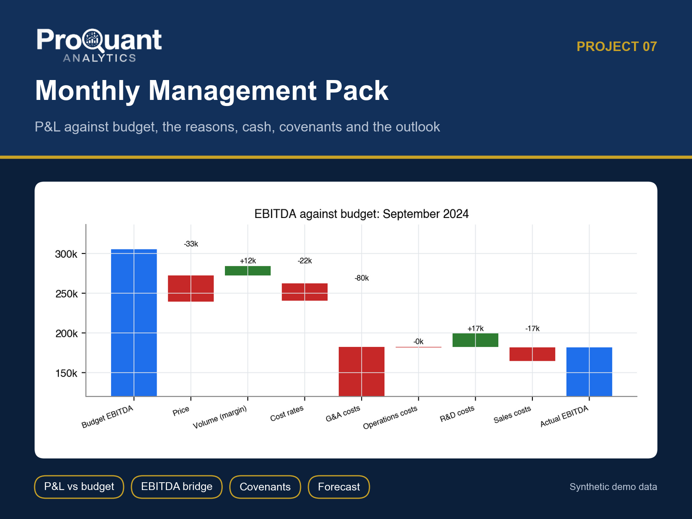
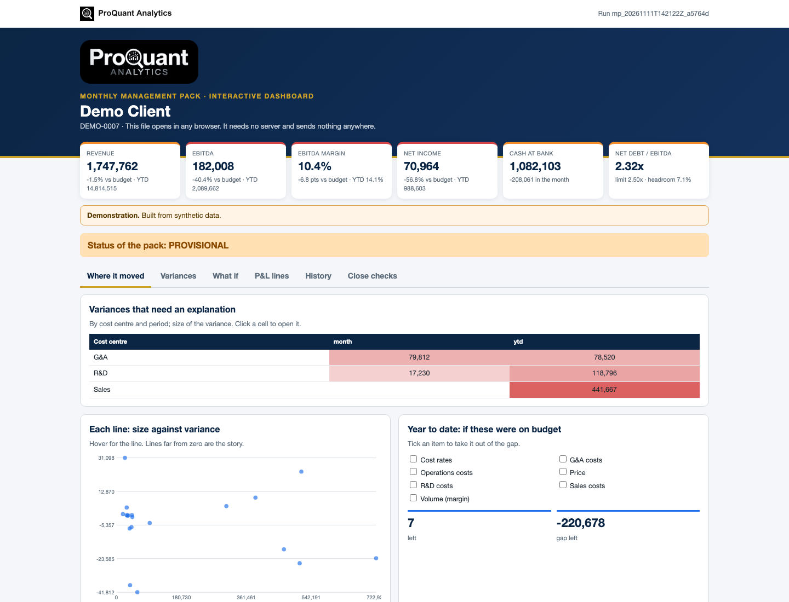
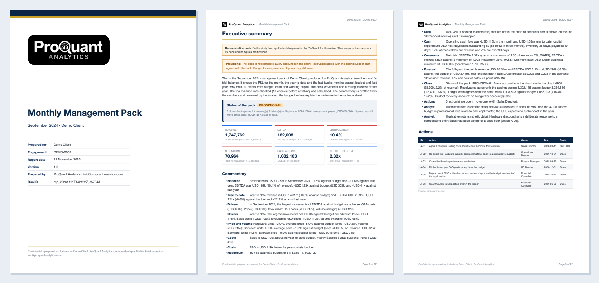
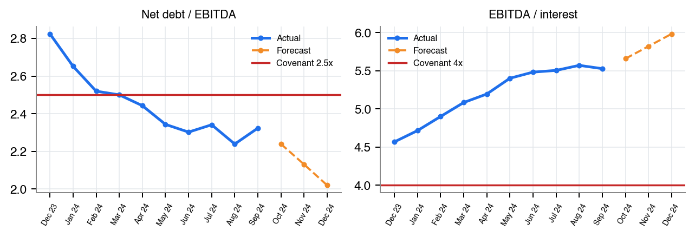
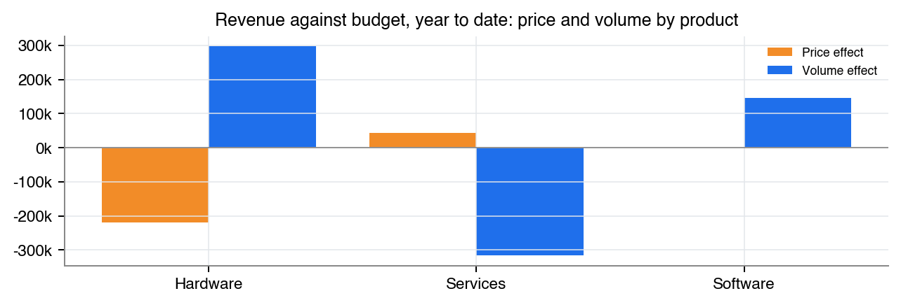
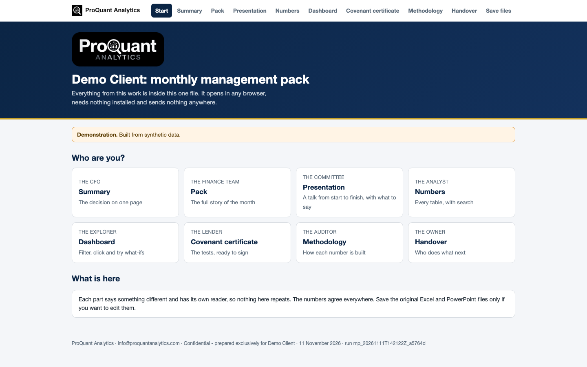

# Monthly Management Pack

**The board pack from the trial balance: P&L vs budget, the reasons, cash, covenants and the year-end outlook.**

  

> **Showcase repository.** It shows the method and the actual files a client receives, built on **synthetic demo data** (a fictional *Demo Client*). The numbers below are illustrative, not client results. The production code is proprietary and is not published here.

## Contents

- [Business problem](#business-problem)
- [Approach](#approach)
- [Results (demo)](#results-demo)
- [Deliverables](#deliverables)
- [Gallery](#gallery)
- [Tech stack](#tech-stack)
- [How to view it](#how-to-view-it)
- [How an engagement works](#how-an-engagement-works)

## Business problem

Management accounts arrive late in a spreadsheet nobody else understands. The P&L shows the variance but not the reason, the cash flow is a guess, and the covenant ratio is calculated the night before the lender's call.

**Typical clients:** CFOs and finance teams of SMEs, PE-backed companies and groups reporting to a board, owner or lender.

## Approach

- P&L for month, YTD and LTM vs budget, prior year and prior month; balance sheet; indirect cash flow
- Price / volume analysis by product and an EBITDA bridge from budget to actual
- Working capital (DSO, DIO, DPO), receivables ageing and headcount vs budget
- Covenant tests (net debt / EBITDA, interest cover, minimum cash), headroom and year-end forecast
- Close checks before anything is calculated; pack status FINAL / PROVISIONAL / HOLD
- Budget-holder variance sheet and a covenant compliance certificate ready for signature

## Results (demo)

**Overall opinion on the demo data:** Status of the pack: PROVISIONAL

| Measure | Value | Context |
|---|---:|---|
| Revenue | **1,747,762** | -1.5% vs budget · YTD 14,814,515 |
| EBITDA | **182,008** | -40.4% vs budget · YTD 2,089,662 |
| EBITDA margin | **10.4%** | -6.8 pts vs budget · YTD 14.1% |
| Net income | **70,964** | -56.8% vs budget · YTD 988,603 |
| Cash at bank | **1,082,103** | -208,061 in the month |
| Net debt / EBITDA | **2.32x** | limit 2.50x · headroom 7.1% |

<em>The interactive dashboard (one HTML file: Where it moved, Variances, What if, P&L lines, History, Close checks). <a href="https://abduwars.github.io/proquant-07-management-pack/sample-delivery/09_DemoClient_MonthlyManagementPack_Dashboard_v1.0_20261111.html">Open it live</a>.</em>

## Deliverables

Everything opens from **one file**, `00_START_HERE`, in any browser: pick your role, read each document, watch the presentation, search the tables and use the dashboard. Each document has one reader and one job, and the numbers agree across all of them.

| # | File | Format | What it is |
|---|---|---|---|
| 00 | [Start here](https://abduwars.github.io/proquant-07-management-pack/sample-delivery/00_START_HERE_DemoClient.html) | HTML (opens in any browser) | **One file that holds it all**: every document, the presentation, the tables and the dashboard |
| 01 | [Report](sample-delivery/01_DemoClient_MonthlyManagementPack_Report_v1.0_20261111.pdf) | PDF | The management pack (~22 pages): status, KPIs, commentary, P&L, variances, price and volume, bridge, costs, balance sheet, cash, covenants, forecast, close checks |
| 02 | [Summary](sample-delivery/02_DemoClient_MonthlyManagementPack_Summary_v1.0_20261111.pdf) | PDF | One page: the decision, with no charts |
| 03 | [Presentation](sample-delivery/03_DemoClient_MonthlyManagementPack_Presentation_v1.0_20261111.pptx) | PowerPoint | **A full talk**: 14 slides with editable charts and speaker notes, ready to present |
| 04 | [Results Workbook](sample-delivery/04_DemoClient_MonthlyManagementPack_ResultsWorkbook_v1.0_20261111.xlsx) | Excel | **The working file**: a Control panel with live formulas, and every table. Opens on a **Read me** sheet with a linked index |
| 05 | [Methodology](sample-delivery/05_DemoClient_MonthlyManagementPack_Methodology_v1.0_20261111.pdf) | PDF | How the pack is built (for auditors, the lender and the client's IT) |
| 06 | [Handover Note](sample-delivery/06_DemoClient_MonthlyManagementPack_HandoverNote_v1.0_20261111.pdf) | PDF | What was delivered, this month, covenants, what we need every month |
| 07 | [Variance Sheet](sample-delivery/07_DemoClient_MonthlyManagementPack_VarianceSheet_v1.0_20261111.xlsx) | Excel | **Budget-holder variance sheet**: each variance above the threshold with owner, hint, columns for the explanation and the action, status drop-down |
| 08 | [Covenant Certificate](sample-delivery/08_DemoClient_MonthlyManagementPack_CovenantCertificate_v1.0_20261111.pdf) | PDF | **Covenant compliance certificate** (one page): inputs, covenants, headroom, outlook to year end, signature block; stamped DRAFT or PROVISIONAL when the pack is not final |
| 09 | [Dashboard](https://abduwars.github.io/proquant-07-management-pack/sample-delivery/09_DemoClient_MonthlyManagementPack_Dashboard_v1.0_20261111.html) | HTML (opens in any browser) | **Interactive dashboard in one file**: opens in any browser, explores the data, tries what-ifs and reads the updated tracker |

Also delivered: data-quality reports and long-format CSV / Parquet exports for Power BI or Looker Studio.

<em>The first pages of the PDF report.</em>

## Gallery

<table><tr>
<td width="50%"></td>
<td width="50%"></td>
</tr></table>

<em>The start page: one file, one click, nothing to install.</em>

## Tech stack

Python · pandas · NumPy · matplotlib · Jinja2 + WeasyPrint (PDF) · openpyxl (Excel) · python-pptx (PowerPoint) · pydantic · pytest

Every run is reproducible and audited: data fingerprints, configuration and code version are recorded, data-quality checks run before any calculation, and an automated test suite checks every deliverable (including opening the decks and workbooks in Microsoft Office).

## How to view it

1. **In the browser (nothing to install):** open the [live start page](https://abduwars.github.io/proquant-07-management-pack/sample-delivery/00_START_HERE_DemoClient.html) or the [dashboard](https://abduwars.github.io/proquant-07-management-pack/sample-delivery/09_DemoClient_MonthlyManagementPack_Dashboard_v1.0_20261111.html).
2. **Download:** click any PDF, Excel or PowerPoint file in the table above, or clone the repository: `git clone https://github.com/AbduWars/proquant-07-management-pack.git`.
3. **On your own data:** this is delivered as a fixed-scope engagement. Write to [info@proquantanalytics.com](mailto:info@proquantanalytics.com).

## How an engagement works

| Step | What happens |
|---|---|
| 1. Discovery call | Your question, your data and the decision the work must support |
| 2. Scope and NDA | Fixed scope, timeline and thresholds agreed **before** any result is seen |
| 3. Data request | A precise list of files or read-only access; personal data pseudonymised |
| 4. Build and interim update | First results, open questions and data issues, early |
| 5. Delivery | The full package above, on your data, with a walk-through |
| 6. Handover | Methodology, runbook where relevant, and optional monthly refresh |

---

<b>ProQuant Analytics</b> · Quant & risk analytics, business analytics and data engineering Rotterdam, NL · remote-first <a href="https://www.proquant-analytics.com">www.proquant-analytics.com</a> · <a href="mailto:info@proquantanalytics.com">info@proquantanalytics.com</a> · <a href="https://github.com/AbduWars">All 12 projects</a>

© 2026 ProQuant Analytics. Sample outputs on synthetic data, shown for demonstration. All rights reserved.

